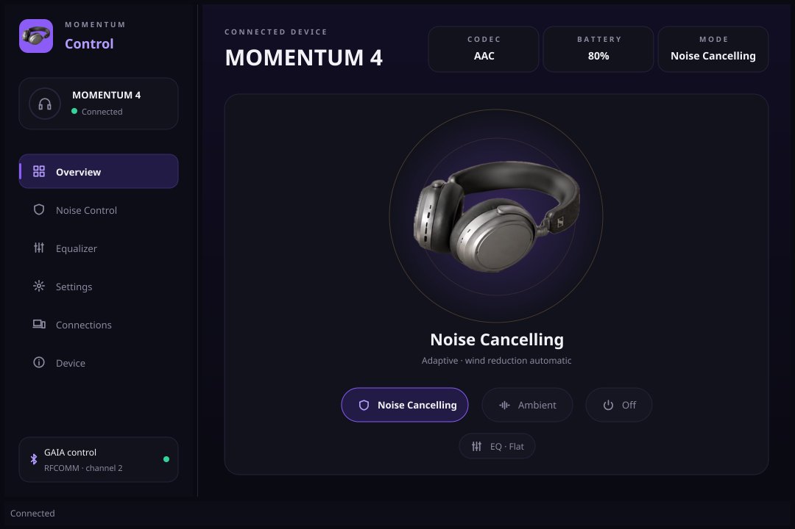

# MOMENTUM 4 Control

A desktop app and command line tool for the Sennheiser MOMENTUM 4 headphones.
They talk to the headphones directly over Bluetooth (RFCOMM), so you can control
noise cancelling, ambient sound, EQ and device settings from your computer
without Sennheiser's phone app.



## Features

- Active noise cancelling on/off
- Ambient sound (Transparent Hearing), with an option to pause music while it is on
- Noise-cancelling strength, adaptive ANC and wind-noise reduction
- 4-band equalizer
- Battery level, audio codec and firmware info
- A **Settings** page: on-head detection, smart pause, auto-answer calls,
  comfort call, sidetone (0-5), voice prompts mode, touch lock, Bluetooth
  compatibility mode and auto power-off (15/30/60 min)
- A **Connections** page (multipoint): see paired devices, and connect,
  disconnect or forget them
- A command line tool, `m4ctl`, including `m4ctl get|set <setting> [value]`

## Platform status

| Platform | Status |
| --- | --- |
| macOS | Verified on real hardware |
| Linux | Experimental: implemented, not yet tested on hardware |
| Windows | Experimental: implemented, not yet tested on hardware |

If you try it on Linux or Windows, please open an issue with your results,
working or not.

## Install

Download the archive for your system from the
[GitHub Releases](https://github.com/mislavperi/momentum-control/releases) page.

**macOS.** Unzip, then move `MOMENTUM 4.app` to Applications. The app is not
signed, so the first time, right-click it and choose **Open**, or clear the
quarantine flag:

```bash
xattr -dr com.apple.quarantine "MOMENTUM 4.app"
```

macOS asks for Bluetooth permission on first launch; allow it, or the app cannot
reach the headphones. The archive also contains `bin/m4ctl.app` and
`scripts/m4ctl` for the command line (see [Usage](#usage)).

**Linux.** Extract the `tar.gz` and run `momentum4` (desktop app) or `m4ctl`
(CLI). Your headphones must already be paired with the machine.

**Windows.** Extract the zip and run `momentum4.exe` (desktop app) or `m4ctl.exe`
(CLI). Your headphones must already be paired with the machine.

## Building from source

Requirements:

- Go 1.25 or newer (see `go.mod`)
- A C compiler. The desktop app uses [Fyne](https://fyne.io), which needs cgo on
  every platform. The Bluetooth code itself needs cgo only on macOS.
- Linux: `sudo apt-get install libgl1-mesa-dev xorg-dev libwayland-dev libxkbcommon-dev` (Debian/Ubuntu names)
- Windows: a C compiler such as MinGW-w64 for the GUI

```bash
make          # macOS: bin/m4ctl.app and "bin/MOMENTUM 4.app"
              # Linux/Windows: bin/m4ctl and bin/momentum4
```

On macOS the Makefile also writes the `Info.plist` files and ad-hoc signs the
bundles, which macOS requires before a process may use Bluetooth.

## Usage

Pair the headphones with your computer first, then:

```bash
open "bin/MOMENTUM 4.app"     # macOS desktop app; elsewhere run bin/momentum4
```

Command line examples (on macOS use `./scripts/m4ctl`, which launches the CLI
bundle through LaunchServices so macOS attaches the Bluetooth permission to it;
elsewhere run `bin/m4ctl`):

```bash
./scripts/m4ctl status               # current settings
./scripts/m4ctl anc on               # noise cancelling on
./scripts/m4ctl hearing on           # Transparent Hearing (ambient sound)
./scripts/m4ctl transparency 40      # 0 = max ANC, 100 = transparent
./scripts/m4ctl get                  # every device setting, with allowed values
./scripts/m4ctl set sidetone 3       # write a setting; it is read back to confirm
./scripts/m4ctl set prompts tones
./scripts/m4ctl hosts                # devices paired with the headphones (multipoint)
./scripts/m4ctl host connect 2       # connect, disconnect or forget a paired device
./scripts/m4ctl -wait status         # keep retrying until the headphones accept
./scripts/m4ctl -h                   # all commands and flags
```

Set `M4_DEBUG=1` to trace every frame in and out.

## Troubleshooting

- **"Connection refused" or the app cannot connect.** The headphones' control
  channel is only intermittently available, and this is a device quirk rather
  than a bug here. The app retries in the background every 30 seconds and
  connects as soon as the device allows. See
  [the notes](docs/protocol.md#the-control-channel-is-only-intermittently-available).
- **Only one controller at a time.** Close Sennheiser's phone app (and
  disconnect it from the headphones), and any other instance of this app or
  `m4ctl`, then try again.
- **macOS: the CLI crashes with no message.** Run it through `./scripts/m4ctl`
  rather than executing the binary directly, and allow the Bluetooth prompt.

## Contributing

Pull requests are welcome. Protocol and reverse-engineering notes live in
[docs/protocol.md](docs/protocol.md), including how to capture Sennheiser's own
app with an Android HCI snoop log and decode it with `cmd/m4snoop` to learn new
commands. Reports from Linux and Windows hardware are especially useful.

## Credits

Protocol groundwork from
[f3Y0/momentum4-control](https://github.com/f3Y0/momentum4-control) (MIT), and
from [justsepi/Momentum4_control_linux](https://github.com/justsepi/Momentum4_control_linux),
whose constants first corrected the ANC model here: `0x1A00` carries `(mode, state)`
pairs for three independent modes, not a single mode selector. That project in
turn credits `m4.json` extracted from Sennheiser's official app by
[zaval/sennheiser-desktop-client](https://github.com/zaval/sennheiser-desktop-client).

[arjun1194/momentum-control-macos](https://github.com/arjun1194/momentum-control-macos)
is an independent macOS implementation; its documentation named the ANC settings
precisely (wind-noise reduction has three levels, adaptive ANC is a separate
toggle) and its SPP framing matches what is described in the
[protocol notes](docs/protocol.md), which is useful corroboration for a
protocol with no specification.

Code derived from f3Y0/momentum4-control and justsepi/Momentum4_control_linux
remains under those projects' MIT license notices.

## License

[MIT](LICENSE). This project is not affiliated with or endorsed by Sennheiser.
